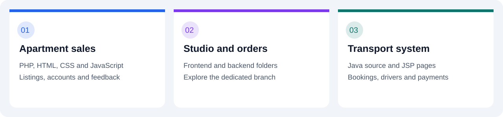
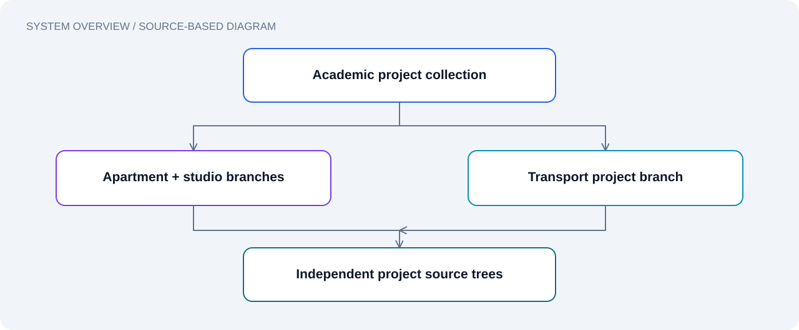

# Academic Projects

**A collection of web application coursework, organized by project branch.**

[Browse projects](#project-directory) · [Get started](#get-started) · [Repository guide](#repository-guide)

---

## Project directory

Each project lives on its own branch. The `main` branch is the entry point for this collection.

| Project | What to explore | Source |
| --- | --- | --- |
| **Online Apartment Sales System** | PHP pages for property listings, accounts, administration, payments and feedback; HTML, CSS, JavaScript and SQL assets | [Open project →](https://github.com/kajanraj400/Academy-project/tree/OnlineApartementSalesSystem) |
| **Online Studio and Order System** | Studio/order project with separate `frontend/` and `backend/` directories | [Open project →](https://github.com/kajanraj400/Academy-project/tree/OnlineStudioAndOrderSystem) |
| **Online Transport System** | Java and JSP application with booking, driver, customer, administration and payment components | [Open project →](https://github.com/kajanraj400/Academy-project/tree/OnlineTransportSystem) |

The descriptions above reflect source files present in the branches. They do not imply that every feature has been executed or tested.

## Get started

Choose **one** project and clone its branch:

### Apartment sales

~~~bash
git clone --single-branch --branch OnlineApartementSalesSystem https://github.com/kajanraj400/Academy-project.git apartment-sales
~~~

Useful starting points:

- [Entry page](https://github.com/kajanraj400/Academy-project/blob/OnlineApartementSalesSystem/index.php)
- [Database schema](https://github.com/kajanraj400/Academy-project/blob/OnlineApartementSalesSystem/SQL%20Query/SalesSystem.sql)
- [Configuration](https://github.com/kajanraj400/Academy-project/blob/OnlineApartementSalesSystem/configuration.php)

Inspect the PHP/database configuration and SQL schema before setting up a local PHP server and database.

### Studio and order system

~~~bash
git clone --single-branch --branch OnlineStudioAndOrderSystem https://github.com/kajanraj400/Academy-project.git studio-orders
~~~

Inspect the [frontend](https://github.com/kajanraj400/Academy-project/tree/OnlineStudioAndOrderSystem/frontend) and [backend](https://github.com/kajanraj400/Academy-project/tree/OnlineStudioAndOrderSystem/backend) manifests and configuration for their dependencies and startup commands.

### Transport system

~~~bash
git clone --single-branch --branch OnlineTransportSystem https://github.com/kajanraj400/Academy-project.git transport-system
~~~

Useful starting points:

- [Java source](https://github.com/kajanraj400/Academy-project/tree/OnlineTransportSystem/src/main/java)
- [JSP pages](https://github.com/kajanraj400/Academy-project/tree/OnlineTransportSystem/src/main/webapp)
- [Web application descriptor](https://github.com/kajanraj400/Academy-project/blob/OnlineTransportSystem/src/main/webapp/WEB-INF/web.xml)
- [Database query file](https://github.com/kajanraj400/Academy-project/blob/OnlineTransportSystem/Database%20Query.txt)

Review the servlet imports, project settings and database connection code to select a compatible Java web server and database configuration.

## Repository guide

| Branch | Purpose |
| --- | --- |
| `main` | Project directory and collection documentation |
| `OnlineApartementSalesSystem` | Apartment sales application |
| `OnlineStudioAndOrderSystem` | Studio/order application |
| `OnlineTransportSystem` | Transport application |

The existing branch spellings are preserved so that project links and checkout commands continue to match the repository.

## Working on a project

1. Check out the relevant project branch.
2. Create a feature or fix branch from that project branch.
3. Make a focused change and record how you verified it.
4. Open a pull request **into the corresponding project branch**.

Use `main` for updates to this collection's landing page. See [CONTRIBUTING.md](CONTRIBUTING.md) for details.

## Status

This is an academic source collection. Local setup has not been executed as part of this presentation update. Screenshots, deployment links and test badges can be added after they are available and verified.

---

Explore the source · Understand the design · Build on the work

## Documentation

[Visual guide](docs/README.md) · [Roadmap](docs/ROADMAP.md) · [Citation](CITATION.cff) · [Licensing](docs/LICENSING.md)
