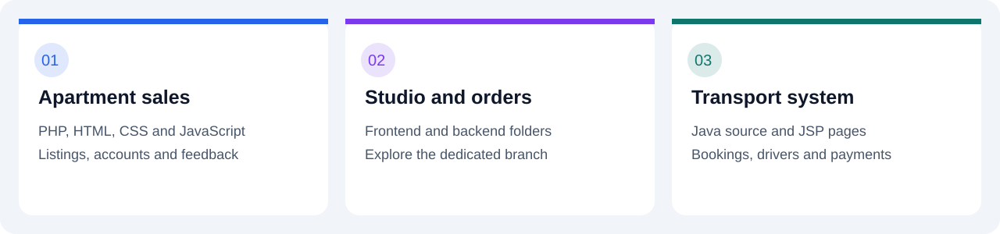
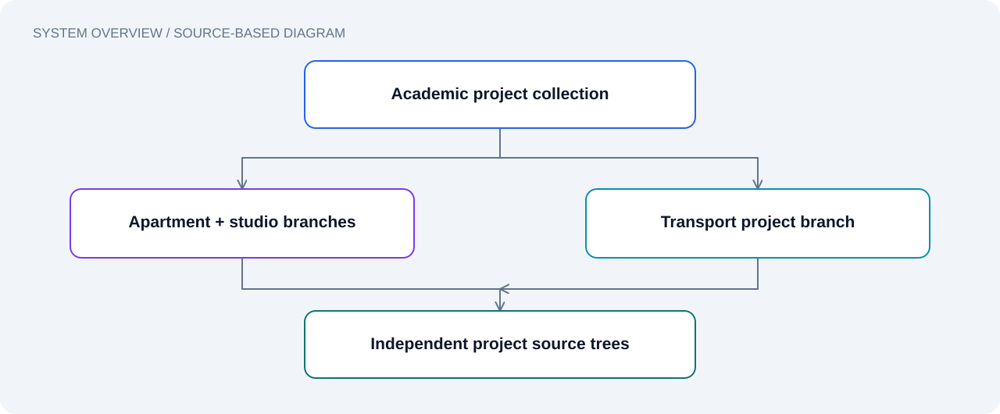

# Documentation

| Document | Purpose |
| --- | --- |
| [Overview](../README.md) | Features and setup |
| [Contributing](../CONTRIBUTING.md) | Change and verification workflow |
| [Roadmap](ROADMAP.md) | Work stages and acceptance criteria |
| [Licensing](LICENSING.md) | Rights review |
| [Citation](../CITATION.cff) | Software citation metadata |

These images illustrate source structure; they are not app screenshots. Store verified captures in `docs/screenshots/` and record the commit, route, viewport and demo input. Exclude personal records.

Keep code in its existing paths. Use `docs/` for documentation and images. Add `notebooks/`, `results/` and `data/README.md` when actual experiments, outputs and provenance are available. Moving model files or databases also requires updating their runtime paths.
